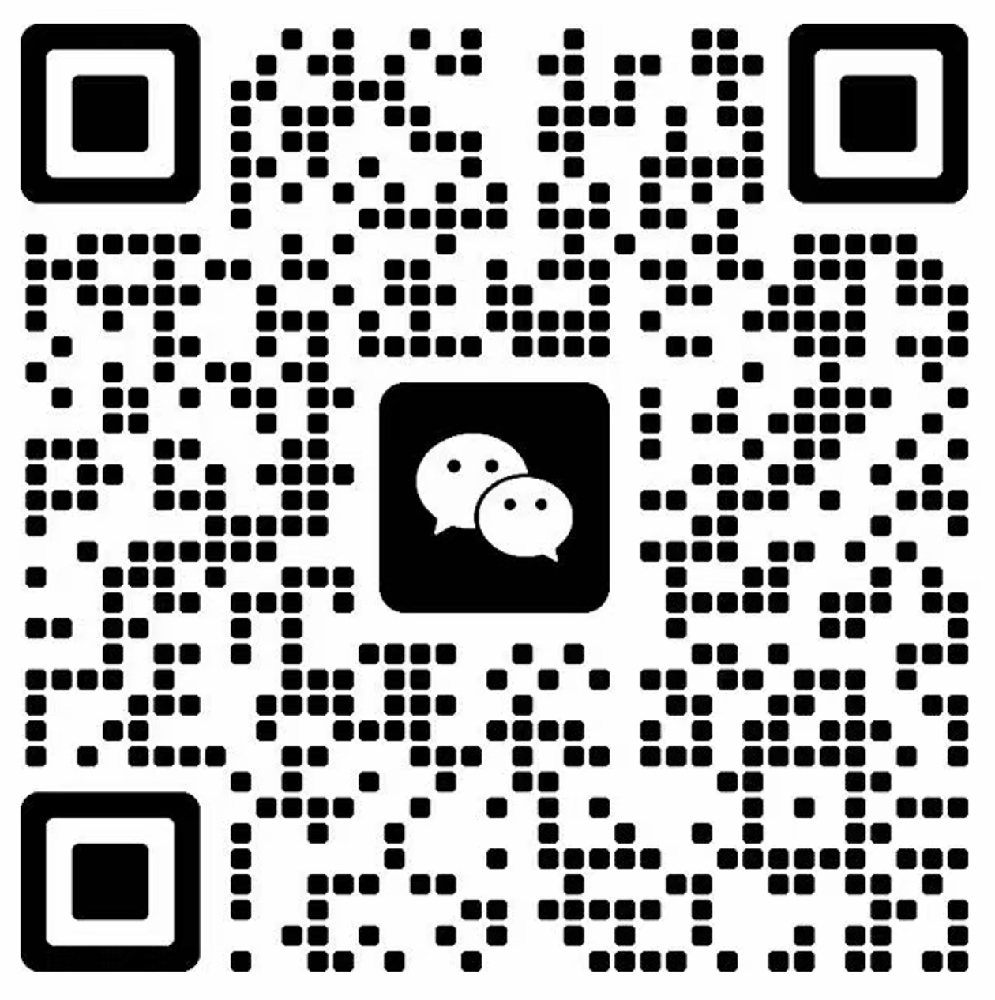

# 个人使用与商业授权

个人非商业使用免费。商用须事先取得书面授权，完整条款见 [LICENSE](LICENSE)。

以下用途需要联系授权：工作或客户项目、公司与团队使用、商业产品集成、
付费分发、收费服务、商业托管及其他商业经营活动。以个人身份为雇主或客户使用也属于商业用途。

微信号：**wubenxincom**

申请时请说明：使用主体、用途、使用人数及是否需要分发或集成。以双方确认的书面授权范围为准。

本项目公开源码供查看与个人非商业使用；公开仓库、下载和 Fork 不代表获得商业许可。
软件使用 Codex 自带接口，与 OpenAI 无官方隶属或背书关系。
