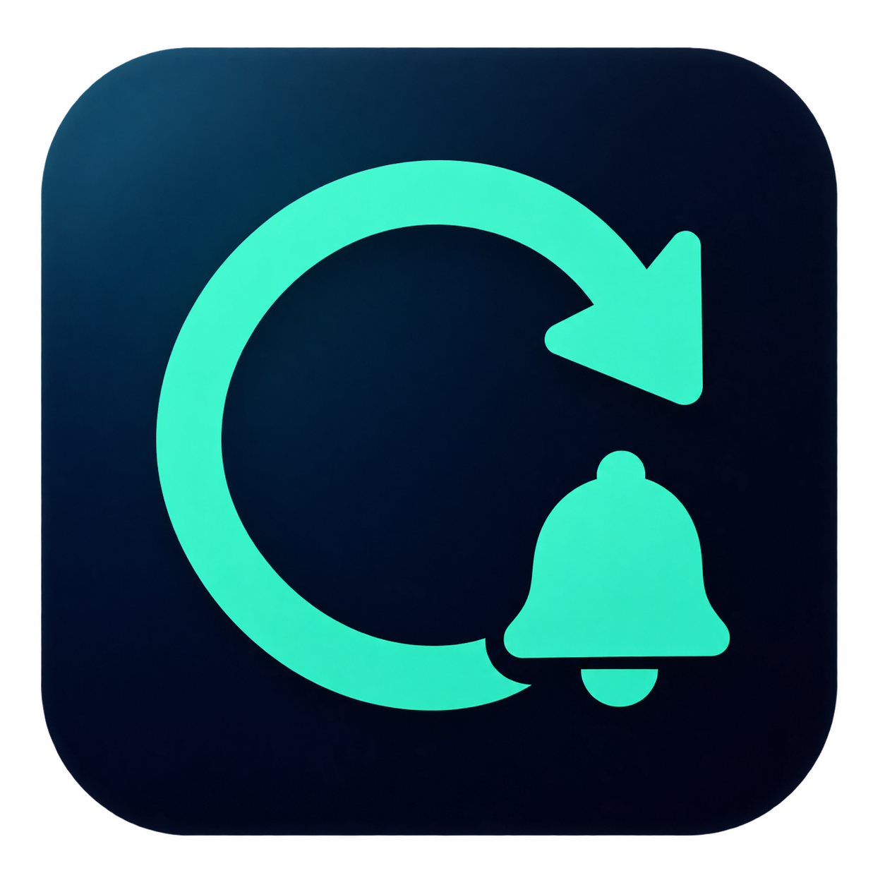

# Codex 额度提醒



菜单栏 / 系统托盘里的 Codex 额度监测工具。持续读取本机 Codex 返回的真实额度，在额度实际恢复时，用声音、弹窗和可选的 iPhone Bark 推送提醒你。

**仅限个人非商业使用；商用须事先取得书面授权。** 详见 [LICENSE](LICENSE) 和 [商业授权说明](COMMERCIAL.md)。

## 下载

前往 [GitHub Releases](https://github.com/hellojeffwu/codex-reset-bar/releases/latest) 下载：

| 平台 | 下载文件 | 前置条件 |
| --- | --- | --- |
| macOS | `CodexResetBar-1.6.0-macOS-universal.dmg` | macOS 14+；Apple Silicon / Intel；本机 Codex 已登录 |
| Windows | `CodexResetBar-1.6.0-windows-x64-setup.exe` | Windows 10/11 x64；Codex CLI 已安装并登录 |

Mac：打开 DMG → 双击「1. 双击安装.pkg」→ 按向导阅读许可、继续并安装 → 双击「2. 安装后双击启动」。应用安装到当前用户的 `~/Applications/Codex 额度提醒.app`，无需拖拽或输入管理员密码。也可单独下载 `.pkg`；安装完成后从 `~/Applications` 打开应用。启动后点击右上角菜单栏图标。

Windows：运行 `-setup.exe` → 下一步 → 阅读许可 → 选择位置和快捷方式 → 安装 → 完成。默认安装到 `%LOCALAPPDATA%\Programs\CodexResetBar`，无需管理员权限，可在完成页启动。安装包自带 .NET 运行时，无需另装 .NET。关闭主窗口后继续留在系统托盘，从托盘菜单退出；如果未自动找到 Codex，可在设置中选择本机 Codex 可执行文件。Release 中不带 `-setup` 的 EXE / ZIP 为便携版。

升级会保留已有提醒设置和 Bark 配置。安装期间需要退出正在运行的本应用；不会关闭其他 Codex 工具。安装不会默认启用开机启动，需在应用内自行设置。

安装包目前未经过 Apple 公证或 Windows Authenticode 签名，系统可能显示来源提示。每个下载提供 SHA256 校验文件。macOS 的本机代码签名验证不等于 Apple 公证。

## 功能

- 每 60 秒读取真实额度；展示套餐、剩余比例、预计重置时间和最近成功检查时间。
- 剩余额度增加至少 1 个百分点，或后端明确从普通额度不可用变成可用时提醒。首次读取只建立基线；预计时间到达本身不会被当作额度恢复。
- 声音每 5 秒重复，直到确认或停止；声音、弹窗和手机通知可以分别设置。
- iPhone 使用 Bark，通知标题和正文可编辑；发送状态可直接查看。
- 自定义剩余额度阈值、预计重置前提醒、指定时间、本轮完成、执行步骤报错和任务提问。最多 30 条规则，每条可选择声音 / 弹窗 / 手机。
- 深色青绿界面，概览与设置分开；iPhone 和关键节点设置也采用相同的分组卡片。
- 统一的青绿循环箭头与铃铛图标，提供 Mac 和 Windows 分步安装向导。

节点通知不会每次检查都重复发送。额度阈值须从阈值上方降至阈值或以下才触发。指定时间只触发一次。任务节点只增量检查本机新事件，首次启动不补发历史；排除子代理。步骤报错默认关闭，某一步失败不等于整个任务失败。问题可能已被随后回答，系统权限审批弹窗暂不覆盖。

## iPhone 推送

1. 在 iPhone 安装 [Bark](https://apps.apple.com/app/id1403753865)，允许通知。
2. 在本工具「提醒设置 → iPhone 推送」粘贴 Bark 首页的官方推送地址，保存并启用。
3. 编辑并保存文案，点击「测试已保存文案」，在手机确认收到。
4. 关键节点的标题、正文和渠道在各自规则中配置；勾选并保存不会立即发送，须等节点触发或点击「测试当前规则」。

使用 Bark 官方 HTTPS 服务，以 POST JSON 发送。标题最多 100 字，正文最多 500 字，总文字最多 2500 UTF-8 字节。服务返回成功仅表示接受请求，实际送达须在 iPhone 确认。请求长响约 30 秒，是否响铃取决于通知权限、静音和专注设置；手机通知不会停止电脑响铃。超时不自动重发，避免重复投递。

Mac 把 Bark Key 保存在钥匙串；Windows 使用当前用户的 DPAPI 加密后保存。不会自动附加聊天内容或工具输出。电脑必须运行并联网，手机不会独立监测额度。

## 隐私和运行边界

通过本机 Codex 的 `app-server --stdio` 执行 `initialize → initialized → account/rateLimits/read`，不读取登录令牌、不启动模型生成。任务节点只使用明确事件类型，不将聊天正文、工具参数和输出加入通知。

显示剩余量使用 `100 - usedPercent`，优先采用 `rateLimitsByLimitId`；实际返回什么额度窗口就显示什么，不假定一定有 5 小时窗口。断网时保留最近成功数据，并显示错误与自动重试状态。休眠或关机期间不能持续查询；两次读取之间发生的变化可能无法完整观测，期间用量增长也可能掩盖小幅恢复。

依赖 Codex 的接口和本机事件格式，未来版本变化可能需要更新。Windows 可执行文件的构建及离线自检可在 [GitHub Actions](https://github.com/hellojeffwu/codex-reset-bar/actions) 核对；Windows 登录账号的真实额度与手机送达仍需在使用设备上确认。

本项目与 OpenAI 无官方隶属或背书关系。

## 联系与商业授权

微信号：**wubenxincom**。应用内「联系与商业授权」也提供二维码和复制微信号按钮。


用于工作、客户项目、公司或团队、商业产品、收费分发或服务前，请先取得书面授权。公开源码、下载和 Fork 不代表商业许可。第三方组件仍适用各自许可证。

## 构建和测试

### macOS

需要 macOS、Apple Command Line Tools、Python 3，以及首次创建本机签名身份时使用的 OpenSSL。

```sh
zsh build.sh
bash scripts/test-swift.sh
CODEX_SIGNING_MODE=local bash scripts/package-macos.sh
bash scripts/verify-macos-package.sh
```

`build.sh` 生成当前架构的本机应用；打包脚本生成 Apple Silicon + Intel 通用 DMG 和 PKG，输出到 `dist/`。只读验证脚本检查向导、当前用户安装域、原子替换、图标、二维码、许可、签名及双架构，不执行安装。CI 还会在临时 runner 中实际执行当前用户安装。CI 使用 `CODEX_SIGNING_MODE=adhoc`，无需本机签名私钥。首次本机构建会在 `~/Library/Application Support/CodexResetBar/signing/` 建立固定签名身份，后续复用；不会把私钥放进源码或安装包，也不修改系统证书信任。不要删除签名资料后继续更新，以免改变钥匙串身份。

更新前应退出所有正在运行的提醒工具，包括手动启动的实例。只卸载 LaunchAgent 不足以停止手动进程；覆盖仍在运行的可执行文件会导致签名校验失败。从临时签名迁移或授权失效时，须由用户在 macOS 系统窗口正常允许钥匙串访问，不要允许所有应用读取密钥。

### Windows

需要 .NET 10 SDK；安装向导还需要 Inno Setup 6.5+。完整说明见 [windows/README.md](windows/README.md)。

```sh
dotnet run --project windows/CodexResetBar.Core.Tests --configuration Release
dotnet publish windows/CodexResetBar -c Release -r win-x64 --self-contained true -p:PublishSingleFile=true -p:IncludeNativeLibrariesForSelfExtract=true
```

Windows PowerShell 中运行 `./scripts/package-windows.ps1 -InstallInnoSetup` 构建安装向导（输入为 `build/windows/CodexResetBar.exe`）。CI 验证安装、升级、离线应用自检、卸载、快捷方式及虚构用户数据保留，并保存欢迎页截图。安装器使用 [Inno Setup](https://jrsoftware.org/)，其第三方许可随包附带。

在 Windows 上运行发布后的 `CodexResetBar.exe --self-test` 可进行不联网、不发通知、不读取已有凭据的离线窗体 / DPAPI 自检。`--probe` 只读真实额度并输出不含账号 ID 的摘要。

## 本地数据与卸载

Mac 数据位于 `~/Library/Application Support/CodexResetBar/`，偏好保存在本应用 UserDefaults；登录启动项为 `~/Library/LaunchAgents/local.benxin.codex-reset-bar.plist`。Windows 数据位于 `%LOCALAPPDATA%/CodexResetBar/`，登录启动使用当前用户的启动设置。

卸载前在设置中关闭登录启动并退出。Mac 移除 `~/Applications/Codex 额度提醒.app`；Windows 可从“设置 → 应用”或开始菜单卸载。卸载会保留本地数据，供重装恢复；可自行备份或移除。不要上传本机状态、Bark Key、钥匙串、签名私钥或 Codex 登录信息。
